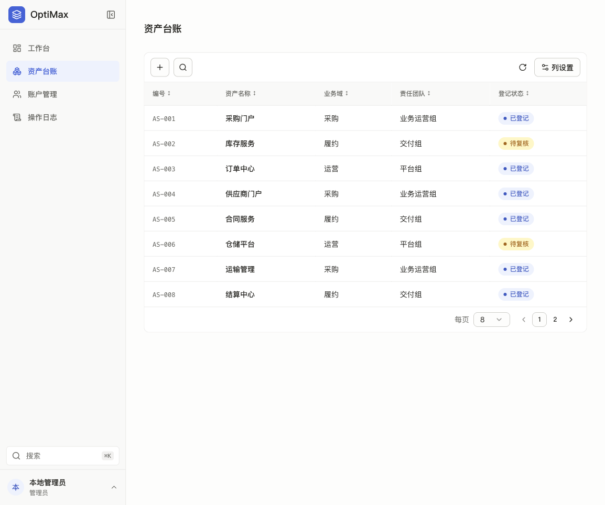
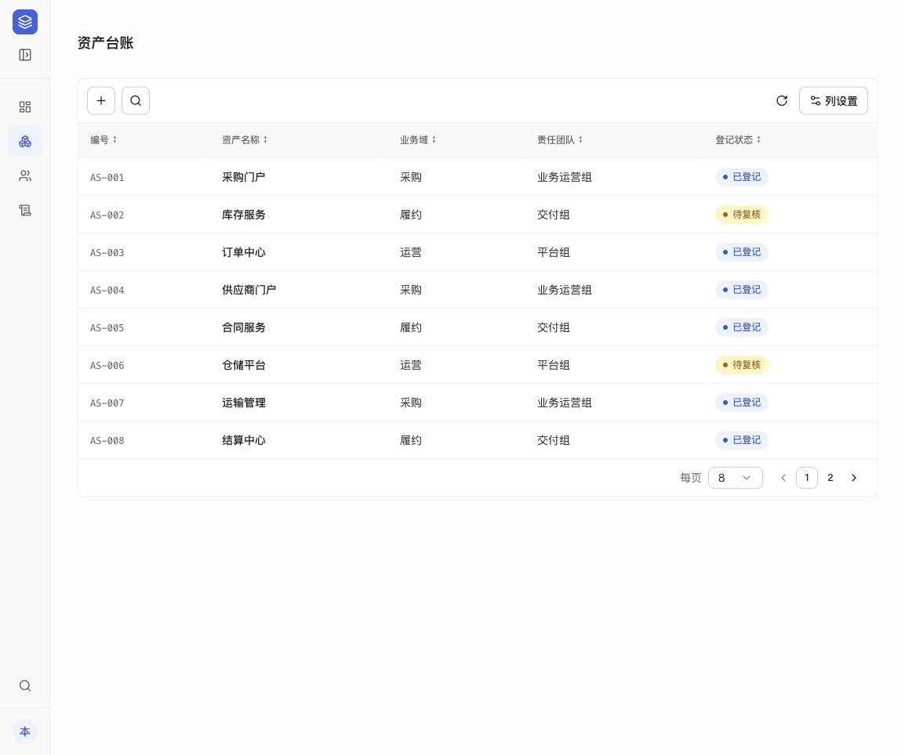

# OptiMax Starter

OptiMax Starter 是一个可直接运行的管理后台脚手架：带账户体系、工作台、资产台账、操作日志和个人设置。完成本地配置初始化后，可用 Docker Compose 启动，新项目以它为起点，并继承 `AGENTS.md` 中的工程与界面规范。资产台账提供[可选的自然语言筛选](./apps/web/src/features/assets/README.md)，默认不启用；服务端可直连 OpenAI-compatible API，不依赖 Magpie 运行，移植代码的来源和许可见 [AI 模块](./apps/server/src/core/ai/README.md)。

[使用此模板创建新项目](https://github.com/wherexml/optimax-starter/generate) · [新项目初始化流程](#从-github-template-初始化新项目)



## 功能与页面

| 路由 | 页面 | 可访问角色 | 说明 |
| --- | --- | --- | --- |
| `/login` | 登录 | 匿名 | 用户名 + 密码，服务端数据库 Session（HttpOnly、SameSite=Strict Cookie） |
| `/` | 工作台 | 全部（`workbench:read`） | 资产统计卡片、业务域分布与下钻；具备审计权限看最近操作，其余看待复核队列；快捷入口按有效权限展示 |
| `/assets` | 资产台账 | 成员只读，管理员与超管可写 | 表格排序、列设置、分页；动态筛选（多选、包含/等于）与可选自然语言筛选 |
| `/accounts` | 账户管理 | 管理员、超级管理员 | 新增、编辑资料、重置密码、强制下线、启停；管理员提权与高权限账户维护仅限超级管理员 |
| `/permissions` | 系统权限 | 超级管理员 | 「模块 × 角色（查看 / 操作）」双按钮权限矩阵、自动联动与二次点击恢复默认 |
| `/system` | 系统配置 | 管理员只读，超级管理员可维护 | 顶部 Tab：`运行控制`（数据库探针、AI 队列水位与一键熔断开关）与 `基础配置`（全局系统时区） |
| `/audit` | 操作日志 | 管理员、超级管理员 | 按操作来源（`人工 / Agent`）、操作类型、操作人、日期筛选，服务端分页并跟随系统时区；只追加且自动脱敏 |
| `/settings` | 个人设置 | 全部已登录账户 | 修改显示名称、邮箱、公司；修改密码后撤销本人全部会话 |

Demo 入口：[/demo/navigation?tab=pending](http://127.0.0.1:38140/demo/navigation?tab=pending)（二级侧栏与顶部 Tab，详见 [导航 Demo](./apps/web/src/features/navigation-demo/README.md)）、[/demo/forms?dialog=create](http://127.0.0.1:38140/demo/forms?dialog=create)（三段式复杂表单弹窗、全套共享输入控件与右下角全局通知，详见 [表单弹窗 Demo](./apps/web/src/features/forms-demo/README.md)），登录账户均可访问。

系统内置超级管理员（`super_admin`）、管理员（`admin`）和成员（`member`）三层角色及持久化模块权限矩阵。所有读写与 Agent 接口均在服务端按实时有效权限裁决，前端菜单隐藏与无权限路由回跳仅用于展示体验。侧栏遵循最多二级规范，支持折叠和移动端抽屉，Cmd/Ctrl+K 打开快速导航。



## 技术栈

| 层 | 选型 |
| --- | --- |
| 前端 | React、Vite、TanStack Router / Query / Table、Tailwind CSS v4、Radix（shadcn 风格组件） |
| 后端 | Hono，常驻进程用 Node 24 运行（`@hono/node-server` + `tsx`） |
| 数据 | PostgreSQL 17、Drizzle ORM（schema push） |
| 校验与安全 | Zod、Argon2id（`@node-rs/argon2`，与原 Bun 哈希格式兼容） |
| 工具链 | Bun 1.3.14（包管理、`db:push`、Vite 开发服务器），全部在容器内运行 |

## 快速开始

前提：Docker 和 Docker Compose v2、OpenSSL（`init-local.sh` 用它生成数据库密码）；运行复验脚本还需要 Python 3。主机不需要安装 Bun 或 Node。仓库当前为私有，克隆前需已有仓库访问权限并完成 GitHub 身份认证。

```sh
git clone https://github.com/wherexml/optimax-starter.git
cd optimax-starter
./scripts/init-local.sh
docker compose up -d --build
```

打开 <http://127.0.0.1:38140/login>，使用本地演示账户：

- 用户名：`demo@optimax.hk`
- 密码：`demo@2026!`

> 演示账户只用于本机开发，不得用于任何生产或对外环境。

`init-local.sh` 只会在 `.env` 中缺少相应条目时写入：数据库密码随机生成；管理员初始密码优先取环境变量 `STARTER_ADMIN_PASSWORD`，没有时使用上面的演示密码。API 启动时仅在演示管理员不存在时创建该账户，并幂等写入 12 条演示资产；数据卷已有数据时不会重置任何密码，之后再修改 `STARTER_ADMIN_PASSWORD` 也不会影响已存在的账户。

## 架构

```text
浏览器 ──▶ web :38140（Vite）──同源 /console 代理──▶ api :38141（Hono / Node 24）──▶ db（PostgreSQL 17，仅 Compose 内部可访问）
```

- 两个端口都只绑定在 `127.0.0.1`；数据库不对主机开放。
- 浏览器只访问同源的 `/console`。API 会校验非 GET 请求的 `Origin` 和 JSON `Content-Type`。
- api 容器每次启动时先执行 `bun run db:push` 同步 schema，再用 Node 启动 API；配置了 `restart: unless-stopped` 和健康检查（`GET /` 返回 `OK`）。为什么不用 Bun 运行 API，见 [RUNTIME.md](./RUNTIME.md)。

### 环境变量

| 变量 | 所在服务 | 作用 |
| --- | --- | --- |
| `STARTER_DB_PASSWORD` | db、api | 数据库密码，由 `init-local.sh` 随机生成并写入 `.env`，不要提交 |
| `STARTER_ADMIN_PASSWORD` | api | 演示管理员首次创建时使用的密码 |
| `DATABASE_URL` | api | 由 compose 拼出的内部连接串（主机名 `db`） |
| `PORT` | api | API 监听端口，默认 `38141` |
| `CORS_ORIGIN` | api | 允许的前端来源，默认 `http://127.0.0.1:38140` |
| `WEB_PORT` / `API_PORT` | web、api | 本地相邻五位监听端口，默认 `38140` / `38141` |
| `API_PROXY_TARGET` | web | Vite `/console` 转发目标，Compose 内默认 `http://api:${API_PORT}`，宿主机直跑可设为 `http://127.0.0.1:${API_PORT}` |
| `SESSION_COOKIE_NAME` | api | Session Cookie 名称，默认 `optimax_console`；新项目由 `bootstrap-project.sh` 自动改为独立名称 |
| `VITE_APP_SLUG` / `VITE_APP_TITLE` | web | 本地存储前缀与侧栏品牌显示名称 |
| `VITE_ENABLE_DEMOS` | web | 是否展示 `/demo/*` 与侧栏 Demo 分组（开发默认 `true`，生产固定 `false`） |
| `STARTER_SEED_DEMO` | api | 是否幂等写入演示管理员与 12 条示例资产（开发默认 `true`，生产强制 `false`） |
| `VITE_SERVER_URL` | web | 前端公开 API 基址配置，完整模板见 [.env.example](./.env.example) |

## 日常命令

```sh
docker compose ps                         # 查看服务和健康状态
docker compose logs -f api                # 跟踪 API 日志
docker compose down                       # 停止服务，保留数据卷
docker compose up -d                      # 日常启动（自动合并 compose.override.yaml 热更新）
docker compose up -d --build              # 修改 package.json / bun.lock 后重建镜像
bun run gen:module vendors --label 供应商  # 一键生成新业务模块（表、Zod 契约、API、页面、验收脚本）
```

仅在明确要清空本地数据库时才执行 `docker compose down -v`；日常停止不要加 `-v`。

本地默认通过 `compose.override.yaml` 挂载 `apps/*/src` 与 `packages/*/src`（保留容器内 Linux 原生 `node_modules`），修改前后端源码即可触发 Vite HMR 与 `node --watch` 秒级热重载，无需每次执行 `--build`；仅在增删依赖或修改 `Dockerfile` 时执行 `docker compose up -d --build`。

## 目录结构（节选）

```text
apps/
  web/src/config/        app-config.ts（品牌、本地存储前缀、侧栏与 Cmd+K 统一导航注册表）
  web/src/routes/        路由、鉴权跳转、URL 搜索参数
  web/src/features/      auth · dashboard · assets · accounts · permissions · system · audit · settings · navigation · filters
  web/src/components/    crud（ResourceTableSlot、ConfirmDialog）、table（DataTable）、filters（FilterBar）、ui（共享弹窗/输入/右下角通知）
  server/src/core/       config · guards（咨询锁与 RBAC）· permissions · system-settings · audit · ai · seed
  server/src/modules/    auth · accounts · system · audit · assets（含服务端分页与 CRUD 示例）
packages/
  api/src/               contracts.ts · permissions.ts · system.ts · asset-agent.ts（前后端共享 Zod 契约与权限矩阵）
  db/src/schema/         console.ts：账户、会话、资产、角色权限矩阵、系统配置、操作日志
scripts/                 init-local.sh · bootstrap-project.sh · gen-module.mjs · ci-scope.mjs · deploy-production.sh · verify-*.py
.github/workflows/       ci.yml · deploy-production.yml
compose.yaml             本地开发基础栈（配合 compose.override.yaml 热更新）
compose.prod.yaml        生产容器编排（配合 Dockerfile.prod 多阶段非 root 构建）
```

## 开发指引

- 页面代码写在 `apps/web/src/features/<模块>/`；`routes/` 只负责路由、鉴权和 `validateSearch`；新增菜单只需在 `apps/web/src/config/app-config.ts` 的 `NAV_REGISTRY` 注册一处，侧栏、抽屉和 `Cmd+K` 快速导航自动同步。
- 标准列表与台账页优先使用 `components/crud/ResourceTableSlot`（组合 `PageHeader`、权限拒绝态、`FilterBar`、`DataTable`、骨架刷新与分页），也可以直接运行 `bun run gen:module <slug> --label <中文名>` 生成全栈骨架。多选（`multi`）和“包含/等于”（`operatorKey`）约定见 [FILTERS.md](./FILTERS.md)。
- 资产台账默认展示客户端筛选与管理员新增/编辑/删除闭环，后端同时提供 `/console/assets/page` 服务端分页 + 动态筛选参考实现。
- 新增后端接口按业务域放在 `apps/server/src/modules/<模块>.ts` 并挂载到 `console.ts`；前后端输入输出 Schema 统一放在 `packages/api/`。管理员写操作必须在同一事务中调用 `audit()` / `auditResource()` 写入 `console_audit`，日志里不得包含密码、哈希、Cookie 或令牌。详见 [AUTH.md](./AUTH.md)。
- 界面规范：侧栏自上而下依次为品牌区（折叠按钮在 Logo 右侧）→ 主导航（最多二级）→ 搜索 → 用户信息与菜单；内容区不设空顶栏；不使用绿色或紫色主题。这是强制基线，见 [AGENTS.md](./AGENTS.md) 和 [FRONTEND.md](./FRONTEND.md)。

## 项目内技能

仓库内置 [starter-ui-sdk](./.agents/skills/starter-ui-sdk/SKILL.md)，用于 UI SDK 交互、组件行为、自定义 primitive 与 Agent 操作。在 Starter 目录运行时，Codex 从 `.agents/skills/` 发现技能；[AGENTS.md](./AGENTS.md#项目技能默认路由) 同时提供按任务读取的明确入口，也可输入 `$starter-ui-sdk`。从公司主仓库进入子项目的会话，按该 AGENTS 链接读取即可。

技能携带上游参考与许可证，并适配现有组件、路由、导航、URL 状态和浏览器 E2E。运行时 UI SDK 仍来自 `apps/web/package.json` 的依赖；技能不会自动替换现有控件或启用模型。

创建新项目时保留整个 `.agents/skills/starter-ui-sdk/`，随 AGENTS 和工程规范一起维护。无需依赖个人全局技能目录；其他客户端可按 AGENTS 链接读取，客户端原生技能发现另按其规则配置。

## 从 GitHub Template 初始化新项目

用模板创建仓库只会复制文件。新仓库的提交历史与本仓库无关，之后也不会自动同步本仓库的更新；模板也不会帮你改任何配置。参考 GitHub 官方文档：[Creating a repository from a template](https://docs.github.com/en/repositories/creating-and-managing-repositories/creating-a-repository-from-a-template)。下文以 `my-console` 为例，`OWNER` 换成你的 GitHub 账户或组织名。

### 1. 创建仓库

需要对本仓库有读取权限。两种方式任选其一：

- 网页：打开 <https://github.com/wherexml/optimax-starter/generate>（也可以在仓库页点 **Use this template → Create a new repository**）。可见性选 **Private**，不要勾选 **Include all branches**（只复制 `main`）。
- 命令行：

```sh
gh repo create OWNER/my-console --template wherexml/optimax-starter --private --clone
cd my-console
git remote get-url origin   # 应输出新仓库的地址，而不是 optimax-starter
```

如果通过网页创建，创建完成后执行 `git clone https://github.com/OWNER/my-console.git` 和 `cd my-console`。不要克隆模板仓库后直接向模板的 `origin` 推送业务代码。

### 2. 首次启动前一键改名与隔离初始化

**必须在第一次 `docker compose up` 之前执行。** 数据卷名由 compose 项目名决定，脚本会自动扫描本机空闲的相邻五位端口（默认从 `38150/38151` 起）、替换 `package.json` 与 `compose.yaml` 项目/镜像名、生成独立 `SESSION_COOKIE_NAME`（避免同机多项目 `127.0.0.1` Cookie 互相覆盖）与随机数据库密码，并更新 `bun.lock`：

```sh
./scripts/bootstrap-project.sh my-console --title "我的运营台"
# 如需正式业务项目默认隐藏 /demo/* 演示分组，可附加 --no-demos；如需指定端口可附加 --web-port 38160
```

另请按产品需要替换 `apps/web/index.html` 的 `<title>`、`public/brand/` 图标与 `app-config.ts` 的 `APP_CONFIG.logoSrc`（配置见 [品牌素材](./apps/web/public/brand/README.md)），并同步更新 `README.md` 与 `PROJECT.md` 中的项目说明（保留 `AGENTS.md` 中的侧栏布局基线等规范）。如需连同 workspace 包命名空间 `@optimax-starter/*` 一并替换，请批量修改各 `package.json` 与 import 后重新运行 `bun install`。

### 3. 启动并确认隔离生效

```sh
docker compose config --quiet                   # 仅校验配置，不打印密码
docker compose up -d --build
docker compose ps                               # api 与 db 应显示 healthy
python3 scripts/verify-console.py               # 自动读取 .env 中的端口与账号完成端到端验收
docker volume inspect my-console-preview_data --format '{{ index .Labels "com.docker.compose.project" }}'
# 应输出 my-console-preview
```

## 复验

前三个脚本在主机上用 Python 3 运行，通过 HTTP 访问正在运行的服务：

| 命令 | 覆盖内容 | 清理 |
| --- | --- | --- |
| `python3 scripts/verify-console.py` | 匿名访问、角色权限、启用/停用、会话撤销、退出 | 结束时自动删除临时成员 |
| `python3 scripts/verify-foundation.py` | 日志事务、权限、日期、分页 | 会保留临时成员供浏览器验收；完成后必须执行 `--cleanup` |
| `python3 scripts/verify-easm-settings.py` | 个人资料、改密、会话撤销 | 会保留夹具；完成后必须执行 `--cleanup`。回滚步骤依赖 settings 夹具，执行 `--cleanup` 前不要手动删除 |
| `python3 scripts/verify-system-governance.py` | 三层角色提权拦截、权限矩阵联动与恢复默认、系统探针、AI 一键熔断、时区回滚、人机双源审计 | 结束时自动清理临时账户与配置 |
| `docker compose exec -T web bun run --filter web check-types` | Vite 生产构建与前端类型检查 | — |
| `docker compose exec -T api bun run --filter server check-types` | 后端类型检查 | — |

`python3 scripts/verify-runtime-load.py` 执行 8 路并发、1,200 次请求；这是短时突发测试，不能代替长时间稳定性测试。上表列的是可执行的检查，不代表在你的环境里已经通过。

脚本使用本地演示账号，并会创建临时数据；仅在专用预览数据库执行。`verify-foundation.py` 会安装针对临时账户的事务失败触发器并在检查后移除。个人设置事务回滚可在 settings 夹具存在时运行 `python3 scripts/verify-easm-rollback.py`，然后执行 `python3 scripts/verify-easm-settings.py --cleanup`。

界面验收还需在浏览器完成登录、筛选增删与多选、账户权限、侧栏展开/折叠、移动端抽屉以及 Cmd/Ctrl+K 导航。完整场景见 [TESTING.md](./TESTING.md)。本机历史验收保存在被 Git 忽略的 `evidence/`；仓库只保留本文展示所需的脱敏演示截图。

## 生产部署与 CI/CD

仓库已内置生产构建与流水线基线（详见 [DEPLOYMENT.md](./DEPLOYMENT.md) 和 [cicd-spec.md](./cicd-spec.md)）：

- **生产镜像与同源托管**：`Dockerfile.prod` 执行多阶段构建并以非 root `node` 用户运行，单容器同源托管 `apps/web/dist` 静态产物与 `/console` API；`compose.prod.yaml` 默认强制 `STARTER_SEED_DEMO=false`、`VITE_ENABLE_DEMOS=false`，并在存在 `packages/db/src/migrations/*.sql` 时优先执行版本化迁移 `db:migrate:deploy`。
- **安全预检与部署回滚入口**：`./scripts/deploy-production.sh` 提供 `--check`（拦截弱密码、默认 Cookie 名与演示种子）、`--deploy <sha>`（在线库备份 → 镜像构建 → 激活 → `/healthz` 与 SPA 冒烟 → 写入 `accepted-sha`）与 `--rollback [<sha>]`。
- **GitHub Actions 门禁**：`.github/workflows/ci.yml` 包含 `ci-scope` 变更分类、PR 并发取消、静态与构建检查及真实 PostgreSQL 17 容器 HTTP/事务回滚 E2E；`.github/workflows/deploy-production.yml` 默认受仓库变量 `ENABLE_PRODUCTION_CD=true` 保护（未配置自托管 `[self-hosted, deploy-prod]` runner 时自动安全跳过，不会排队卡死）。
- **业务项目仍需按需评估**：当前内置三层 RBAC（`super_admin` / `admin` / `member`）与模块级「查看 / 操作」权限矩阵，多租户组织隔离、企业 SSO（已预留 `/console/auth/providers` 扩展位）及更严格密码策略按具体产品需求补齐。

## 文档导航

| 文档 | 内容 |
| --- | --- |
| [AGENTS.md](./AGENTS.md) | 协作规则、强制布局基线、按任务阅读的入口 |
| [TESTING.md](./TESTING.md) | 验证命令与浏览器验收旅程 |
| [DESIGN.md](./DESIGN.md) | 视觉、交互与组件规范 |
| [FRONTEND.md](./FRONTEND.md) | 前端结构、外壳、筛选、动效与组件来源 |
| [AUTH.md](./AUTH.md) | 身份、Session、角色权限、操作日志契约 |
| [FILTERS.md](./FILTERS.md) | 筛选组件与 URL 参数约定 |
| [EASM_REUSE.md](./EASM_REUSE.md) | 工作台、用户菜单、个人设置的移植说明 |
| [REUSE.md](./REUSE.md) | 复用来源总表 |
| [RUNTIME.md](./RUNTIME.md) | API 运行时选择、已知限制与恢复记录 |
| [DEPLOYMENT.md](./DEPLOYMENT.md) | 部署说明 |
| [SPEC_ADOPTION.md](./SPEC_ADOPTION.md) | 团队规范（spec）基线的采用情况与差异 |
| [PROJECT.md](./PROJECT.md) | 项目事实摘要 |

部分继承的专项规范仍含待填写模板；它们描述新项目应补齐的约定，不代表所有基础设施已经实现。当前功能以代码、本文和 [PROJECT.md](./PROJECT.md) 为准。

## 来源与致谢

- 工程骨架基于 Better-T-Stack 生成的 monorepo。
- 登录页移植自 OptiMax RiskOps：全屏地图、渐变遮罩、品牌 SVG 和右侧登录卡。
- 表格、列设置、分页、FormDialog、条件筛选、多选、工作台、用户菜单和个人设置改编自 Skylance EASM。
- 快速导航参考 OptiONE 的 search-command。

各项的具体改动见 [REUSE.md](./REUSE.md) 和 [EASM_REUSE.md](./EASM_REUSE.md)。本 README 不声明许可条款，以仓库中的实际文件为准。
