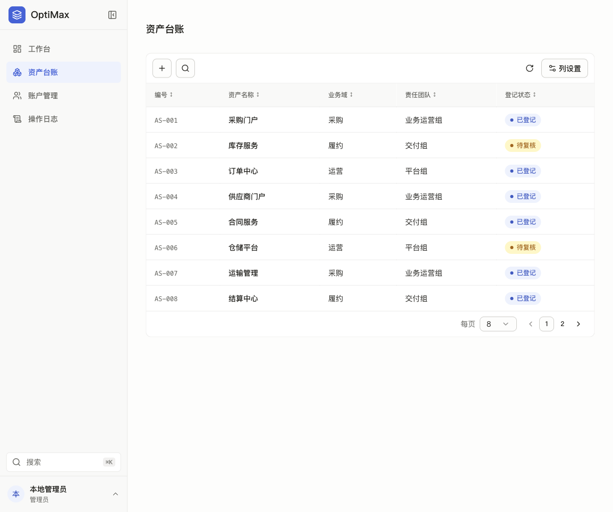
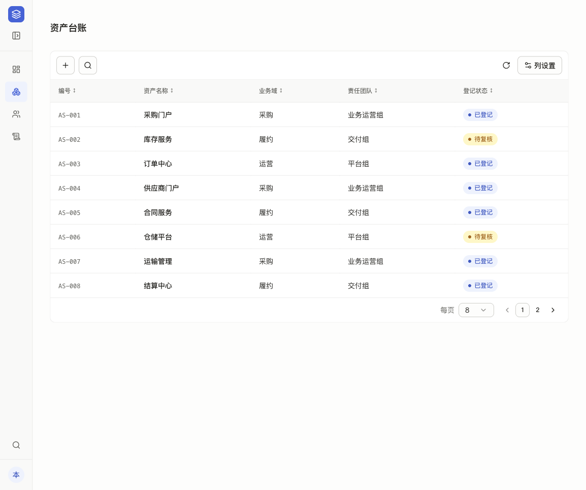

# OptiMax Starter

OptiMax Starter 是一个可直接运行、不含 AI 的管理后台脚手架：带账户体系、工作台、资产台账、操作日志和个人设置。完成本地配置初始化后，可用 Docker Compose 启动，新项目以它为起点，并继承 `AGENTS.md` 中的工程与界面规范。



## 功能与页面

| 路由 | 页面 | 可访问角色 | 说明 |
| --- | --- | --- | --- |
| `/login` | 登录 | 匿名 | 用户名 + 密码，服务端数据库 Session（HttpOnly、SameSite=Strict Cookie） |
| `/` | 工作台 | 管理员、成员 | 资产统计卡片、业务域分布与下钻；管理员看最近操作，成员看待复核队列；快捷入口 |
| `/assets` | 资产台账 | 管理员、成员 | 表格排序、列设置、分页；动态筛选（多选、包含/等于） |
| `/accounts` | 账户管理 | 管理员 | 新增、编辑姓名、调整角色、重置密码、强制下线、启用/停用 |
| `/audit` | 操作日志 | 管理员 | 按操作类型、操作人、日期筛选，服务端分页；日志只追加 |
| `/settings` | 个人设置 | 管理员、成员 | 修改显示名称、邮箱、公司；修改密码后撤销本人全部会话 |

角色只有管理员（`admin`）和成员（`member`）两种。所有写操作都在服务端再次校验权限，前端隐藏入口只用于展示。侧栏支持折叠和移动端抽屉，Cmd/Ctrl+K 打开快速导航。



## 技术栈

| 层 | 选型 |
| --- | --- |
| 前端 | React、Vite、TanStack Router / Query / Table、Tailwind CSS v4、Radix（shadcn 风格组件） |
| 后端 | Hono，常驻进程用 Node 24 运行（`@hono/node-server` + `tsx`） |
| 数据 | PostgreSQL 17、Drizzle ORM（schema push） |
| 校验与安全 | Zod、Argon2id（`@node-rs/argon2`，与原 Bun 哈希格式兼容） |
| 工具链 | Bun 1.3.14（包管理、`db:push`、Vite 开发服务器），全部在容器内运行 |

## 快速开始

前提：Docker 和 Docker Compose v2、OpenSSL（`init-local.sh` 用它生成数据库密码）；运行复验脚本还需要 Python 3。主机不需要安装 Bun 或 Node。仓库当前为私有，克隆前需已有仓库访问权限并完成 GitHub 身份认证。

```sh
git clone https://github.com/wherexml/optimax-starter.git
cd optimax-starter
./scripts/init-local.sh
docker compose up -d --build
```

打开 <http://127.0.0.1:38140/login>，使用本地演示账户：

- 用户名：`demo@optimax.hk`
- 密码：`demo@2026!`

> 演示账户只用于本机开发，不得用于任何生产或对外环境。

`init-local.sh` 只会在 `.env` 中缺少相应条目时写入：数据库密码随机生成；管理员初始密码优先取环境变量 `STARTER_ADMIN_PASSWORD`，没有时使用上面的演示密码。API 启动时仅在演示管理员不存在时创建该账户，并幂等写入 12 条演示资产；数据卷已有数据时不会重置任何密码，之后再修改 `STARTER_ADMIN_PASSWORD` 也不会影响已存在的账户。

## 架构

```text
浏览器 ──▶ web :38140（Vite）──同源 /console 代理──▶ api :38141（Hono / Node 24）──▶ db（PostgreSQL 17，仅 Compose 内部可访问）
```

- 两个端口都只绑定在 `127.0.0.1`；数据库不对主机开放。
- 浏览器只访问同源的 `/console`。API 会校验非 GET 请求的 `Origin` 和 JSON `Content-Type`。
- api 容器每次启动时先执行 `bun run db:push` 同步 schema，再用 Node 启动 API；配置了 `restart: unless-stopped` 和健康检查（`GET /` 返回 `OK`）。为什么不用 Bun 运行 API，见 [RUNTIME.md](./RUNTIME.md)。

### 环境变量

| 变量 | 所在服务 | 作用 |
| --- | --- | --- |
| `STARTER_DB_PASSWORD` | db、api | 数据库密码，由 `init-local.sh` 随机生成并写入 `.env`，不要提交 |
| `STARTER_ADMIN_PASSWORD` | api | 演示管理员首次创建时使用的密码 |
| `DATABASE_URL` | api | 由 compose 拼出的内部连接串（主机名 `db`） |
| `PORT` | api | API 监听端口，默认 `38141` |
| `CORS_ORIGIN` | api | 允许的前端来源，默认 `http://127.0.0.1:38140` |
| `VITE_SERVER_URL` | web | 前端 API 基址配置，当前也供保留的 tRPC 基础代码使用；管理页面 `/console` 的代理目标在 `apps/web/vite.config.ts` 中单独配置为 `http://api:38141` |

## 日常命令

```sh
docker compose ps                 # 查看服务和健康状态
docker compose logs -f api        # 跟踪 API 日志
docker compose down               # 停止服务，保留数据卷
docker compose up -d --build      # 修改代码或拉取更新后重建镜像
```

仅在明确要清空本地数据库时才执行 `docker compose down -v`；日常停止不要加 `-v`。

镜像在构建时复制源码，容器不挂载源码目录。因此修改源码或 `git pull` 之后，必须执行 `docker compose up -d --build` 才会生效。

## 目录结构（节选）

```text
apps/
  web/src/routes/        路由、鉴权跳转、URL 搜索参数
  web/src/features/      auth · dashboard · assets · accounts · audit · settings · navigation · filters
  web/src/components/    table（EASM DataTable）、filters（FilterBar）、ui（Radix 控件、FormDialog、MultiSelect）
  server/src/            console.ts（API、Session、鉴权、日志）、node.ts（Node 入口）、password.ts
packages/
  db/src/schema/         console.ts：账户、会话、资产、操作日志
scripts/                 init-local.sh 与复验脚本
docs/images/             README 截图
compose.yaml             web / api / db 三个服务
```

## 开发指引

- 页面代码写在 `apps/web/src/features/<模块>/`；`routes/` 只负责路由、鉴权和 `validateSearch`。
- 列表页统一使用 `components/table/DataTable` 和 `components/filters/FilterBar`。多选（`multi`）和“包含/等于”（`operatorKey`）需要逐字段开启，查询链路没有实现对应匹配语义的字段不要开启。约定见 [FILTERS.md](./FILTERS.md)。
- 资产台账一次取回全部记录，在浏览器端筛选，适合演示规模的数据；数据量大时应改为服务端筛选和分页（操作日志已经是服务端分页）。
- 新增 API 写在 `apps/server/src/console.ts`。管理员写操作必须在同一事务中写入操作日志，日志里不得包含密码、哈希、Cookie 或令牌。详见 [AUTH.md](./AUTH.md)。
- 界面规范：侧栏自上而下依次为品牌区（折叠按钮在 Logo 右侧）→ 主导航 → 搜索 → 用户信息与菜单；内容区不设空顶栏；不使用绿色或紫色主题。这是强制基线，见 [AGENTS.md](./AGENTS.md) 和 [FRONTEND.md](./FRONTEND.md)。

## 从脚手架派生新项目

目前没有自动生成脚本，需要手动完成：

1. 复制仓库源码，不要复制本项目的 `.git`、`.env`、`evidence/`、`tasks/` 或任何本地运行数据；为新项目建立独立仓库与远端。
2. 一并带走 `AGENTS.md` 及相关文档（FRONTEND、AUTH、FILTERS、RUNTIME、REUSE 等），并遵守其中的侧栏布局基线。
3. 在 `compose.yaml` 中修改：
   - 顶层 `name`（compose 项目名）和 `image` 标签，都要唯一，否则会与本项目共用数据卷或镜像；
   - 端口：选一对相邻、未被占用的五位端口（例如 `38150`/`38151`），并同步修改端口映射、`PORT`、`CORS_ORIGIN`、`VITE_SERVER_URL`、API 健康检查地址，以及 `apps/web/vite.config.ts` 中的 `server.port` 和 `/console` 代理目标；测试脚本的预览地址也要同步。
4. 如有需要，修改 `package.json` 名称和 `@optimax-starter/*` 包命名空间（注意同步所有引用）。
5. 运行新项目自己的 `./scripts/init-local.sh`，生成独立的 `.env`。演示账户只能用于本地。

## 复验

前三个脚本在主机上用 Python 3 运行，通过 HTTP 访问正在运行的服务：

| 命令 | 覆盖内容 | 清理 |
| --- | --- | --- |
| `python3 scripts/verify-console.py` | 匿名访问、角色权限、启用/停用、会话撤销、退出 | 结束时自动删除临时成员 |
| `python3 scripts/verify-foundation.py` | 日志事务、权限、日期、分页 | 会保留临时成员供浏览器验收；完成后必须执行 `--cleanup` |
| `python3 scripts/verify-easm-settings.py` | 个人资料、改密、会话撤销 | 会保留夹具；完成后必须执行 `--cleanup`。回滚步骤依赖 settings 夹具，执行 `--cleanup` 前不要手动删除 |
| `docker compose exec -T web bun run --filter web check-types` | Vite 生产构建与前端类型检查 | — |
| `docker compose exec -T api bun run --filter server check-types` | 后端类型检查 | — |

`python3 scripts/verify-runtime-load.py` 执行 8 路并发、1,200 次请求；这是短时突发测试，不能代替长时间稳定性测试。上表列的是可执行的检查，不代表在你的环境里已经通过。

脚本使用本地演示账号，并会创建临时数据；仅在专用预览数据库执行。`verify-foundation.py` 会安装针对临时账户的事务失败触发器并在检查后移除。个人设置事务回滚可在 settings 夹具存在时运行 `python3 scripts/verify-easm-rollback.py`，然后执行 `python3 scripts/verify-easm-settings.py --cleanup`。

界面验收还需在浏览器完成登录、筛选增删与多选、账户权限、侧栏展开/折叠、移动端抽屉以及 Cmd/Ctrl+K 导航。完整场景见 [TESTING.md](./TESTING.md)。本机历史验收保存在被 Git 忽略的 `evidence/`；仓库只保留本文展示所需的脱敏演示截图。

## 上线前须知

本仓库目前是本地预览形态，直接上线前至少要处理以下几点：

- web 运行的是 Vite 开发服务器，API 由 `tsx` 在运行时转译。生产环境应先构建再运行。
- 数据库结构用 `drizzle push` 同步，没有版本化迁移。
- 权限只有管理员和成员两种，没有多租户、OAuth/SSO 或细粒度权限。
- 不集成任何 AI 服务。
- 演示账户和本地 `.env` 不得带入生产；密码策略只要求 10–256 位。
- 当前没有 `.github/workflows`，尚未配置 CI/CD；`cicd-spec.md` 是规范文档，不代表流水线已经运行。

## 文档导航

| 文档 | 内容 |
| --- | --- |
| [AGENTS.md](./AGENTS.md) | 协作规则、强制布局基线、按任务阅读的入口 |
| [TESTING.md](./TESTING.md) | 验证命令与浏览器验收旅程 |
| [DESIGN.md](./DESIGN.md) | 视觉、交互与组件规范 |
| [FRONTEND.md](./FRONTEND.md) | 前端结构、外壳、筛选、动效与组件来源 |
| [AUTH.md](./AUTH.md) | 身份、Session、角色权限、操作日志契约 |
| [FILTERS.md](./FILTERS.md) | 筛选组件与 URL 参数约定 |
| [EASM_REUSE.md](./EASM_REUSE.md) | 工作台、用户菜单、个人设置的移植说明 |
| [REUSE.md](./REUSE.md) | 复用来源总表 |
| [RUNTIME.md](./RUNTIME.md) | API 运行时选择、已知限制与恢复记录 |
| [DEPLOYMENT.md](./DEPLOYMENT.md) | 部署说明 |
| [SPEC_ADOPTION.md](./SPEC_ADOPTION.md) | 团队规范（spec）基线的采用情况与差异 |
| [PROJECT.md](./PROJECT.md) | 项目事实摘要 |

部分继承的专项规范仍含待填写模板；它们描述新项目应补齐的约定，不代表所有基础设施已经实现。当前功能以代码、本文和 [PROJECT.md](./PROJECT.md) 为准。

## 来源与致谢

- 工程骨架基于 Better-T-Stack 生成的 monorepo。
- 登录页移植自 OptiMax RiskOps：全屏地图、渐变遮罩、品牌 SVG 和右侧登录卡。
- 表格、列设置、分页、FormDialog、条件筛选、多选、工作台、用户菜单和个人设置改编自 Skylance EASM。
- 快速导航参考 OptiONE 的 search-command。

各项的具体改动见 [REUSE.md](./REUSE.md) 和 [EASM_REUSE.md](./EASM_REUSE.md)。本 README 不声明许可条款，以仓库中的实际文件为准。
