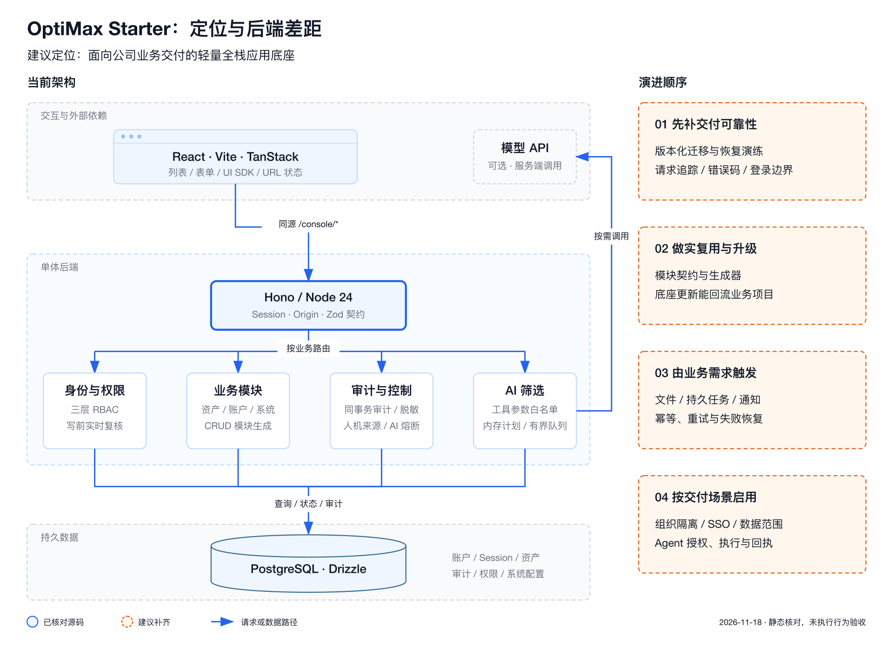

# Starter 定位与后端差距

2026-11-18，Asia/Singapore。本轮核对本地源码、配置、生成器和部署脚本，并回读竞品官方文档。属于架构评估；未进行压力测试、安全攻击测试、生产排查或候选安装，未改变产品行为。下文的优先级和定位均为建议，尚不是已批准的实施范围。

## 判断

建议定位：**面向公司业务交付、可持续升级的轻量全栈应用底座。**

当前已经有可运行前后端、账户与权限、事务审计、模块生成、工程规范和可选 AI 筛选。现阶段适合单组织或按客户独立部署的台账、运营后台和轻量业务系统。复杂审批、跨系统同步、多租户 SaaS、长时间自主 Agent 执行需要额外建设。

主要差距是基础能力的完整性、可恢复性和跨项目升级能力。Hono 本身不是决定性差距；supastarter 的官方后端同样采用 Hono。建议保留 TypeScript + Hono + PostgreSQL 的模块化单体结构，先完善共同契约和交付闭环。[supastarter API 文档](https://supastarter.dev/docs/tanstack-start)

[可编辑 SVG](./2026-11-18-starter-position.svg)。蓝色为已核对的当前能力，橙色虚线框为建议；箭头表示请求/数据关系，不代表分布式服务或独立进程。

## 已有的后端基础

| 能力 | 源码确认的实现 | 边界 |
| --- | --- | --- |
| 身份与会话 | Argon2id；数据库 Session，仅存令牌摘要；启停、撤销、改密后退出 | 账户名密码登录；SSO 仅有 provider 发现入口 |
| 服务端权限 | 三层角色、模块查看/操作权限；业务写入在事务内重新检查账户和权限 | 固定角色、模块级授权；没有组织/行级数据范围 |
| 审计 | 业务写入与审计同事务；递归敏感键脱敏；human / agent 来源 | 应用写路径只追加，不据此宣称数据库防篡改或完整运行追踪 |
| 数据与契约 | PostgreSQL、Drizzle、共享 Zod/DTO；分页接口与生成器 | 共享 TypeScript 契约不等于已有 OpenAPI 或独立外部 SDK |
| AI 接入 | 工具白名单、参数校验、总超时、有界队列、单用户额度、熔断 | 可选筛选试点；计划状态和并发水位在进程内 |
| 交付 | Compose、生产镜像、健康探针、备份、镜像回切、CI/HTTP E2E 脚本 | 本轮未复跑 CI/E2E；脚本存在不等于生产恢复能力已验证 |

事实入口：[服务端](../../apps/server/README.md)、[认证事实卡](../../AUTH.md#2-认证事实卡)、[后端事实卡](../../BACKEND.md#4-后端事实卡)、[API 事实卡](../../API_CONVENTIONS.md#2-api-事实卡)。代码定位见下文。

## 优先补齐的差距

### 1. 迁移与恢复：已有入口，尚缺固定基线

**确认：** `packages/db/src/migrations/` 目前只有 `.gitkeep`。生产 Compose 在没有 SQL 文件时回退执行 `db:push`。部署前有 `pg_dump`，失败回切使用旧镜像，数据库恢复仍是文档中的人工步骤。

**影响：** 多个项目复制后，各环境可能产生不同 schema 演进记录；回切应用镜像不自动撤销数据库变化。对不兼容迁移，需要先停止进一步变更、核对恢复点与旧版本兼容性。

**建议先做：** 建立初始 SQL 与版本记录，生产强制版本化迁移；采用兼容新旧应用的变更顺序；通过隔离数据库的备份恢复与旧版本读取演练建立证据。自动恢复真实数据库不在本次范围。

证据：[生产启动逻辑](../../compose.prod.yaml)、[发布与镜像回切](../../scripts/deploy-production.sh)、[恢复约定](../../DEPLOYMENT.md#6-回滚与数据恢复)。

### 2. 请求诊断与登录边界：需要形成可复制保证

**确认：** 入口使用 Hono logger；常规业务错误主要是 `{ error: 中文文案 }`，AI 客户端另有稳定错误 code。`requestId` 与登录限流在事实卡中交由网关/反代配置，本应用未提供统一请求关联实现或登录限流中间件。登录 Cookie 设置 HttpOnly / SameSite，但当前调用未显式设置 Secure；请求体大小限制仅在 AI 子路由可见。

**影响：** 新业务项目仍要自行补齐并核验入口配置；用户报错、业务审计与上游模型错误难以用一个 ID 关联。不能仅凭应用代码断言某个实际生产网关没有防护，本轮没有检查任何生产反代。

**建议先做：** 稳定错误码、请求 ID、结构化脱敏日志和最低健康/异常指标；生产 HTTPS Cookie、登录限流、请求体边界形成明确配置与 E2E。先覆盖失败恢复与诊断，不要求立即引入完整监控平台。

证据：[应用入口](../../apps/server/src/index.ts)、[登录与 Cookie](../../apps/server/src/modules/auth.ts)、[错误封装](../../apps/server/src/core/guards.ts)、[事实卡](../../API_CONVENTIONS.md#2-api-事实卡)。

### 3. 复用与升级：可以复制，尚未闭合升级路径

**确认：** GitHub Template 创建后不会自动同步底座。`packages/ui` 为私有 workspace 包、版本 `0.0.0`；后端 core 也随应用源码复制。`gen:module` 已能生成表、契约、分页 CRUD、审计、页面和 E2E，但模板字段固定为名称、分类、负责人、状态等。

**影响：** 改一次权限、审计或共享控件，后续业务项目仍需分别合并；生成器能减少起步工作，但不是任意业务模型生成器。复杂关联、状态流转和集成逻辑仍需设计。

**建议先做：** 明确哪些底座代码允许业务修改、哪些通过版本升级；记录采用版本、兼容变更与最小升级验证。对实际重复的模块形成一致契约，再决定采用私有包、更新脚本或模板补丁。复杂业务出现时提取 service/use-case，保持简单 CRUD 的实现直接可读。

证据：[模板说明](../../README.md#从-github-template-初始化新项目)、[共享 UI 包](../../packages/ui/package.json)、[生成器](../../scripts/gen-module.mjs)。

## 由业务需求触发的扩展

| 差距 | 当前事实与业务影响 | 何时值得补 |
| --- | --- | --- |
| 持久任务 | AI FIFO 是并发准入控制；没有任务表、常驻 worker、失败重试与重启续跑 | 报告生成、导入导出、扫描、定时同步等长任务出现时 |
| 文件与通知 | API 事实卡明确无文件入口；没有通用用户文件存储或通知交付模块 | 附件、报告文件、完成通知成为真实业务流程时 |
| 集成与幂等 | 当前是同源浏览器 Session + Origin/JSON 接口，没有通用对外 Webhook 或业务幂等执行记录 | 接入飞书、客户系统、支付/回调，或需要自动重试写操作时 |
| 组织与数据范围 | schema 无组织/成员关系，账户 `company` 是资料文本；RBAC 只有模块权限 | 一个实例服务多个组织或部门数据必须隔离时；独立部署可继续保留当前简单边界 |
| SSO 与账户流程 | `/auth/providers` 返回配置入口，没有 OIDC callback、身份绑定或组织邀请闭环 | 客户统一登录、账号生命周期或邀请入驻成为交付要求时 |
| Agent 执行 | 当前唯一业务工具为 `apply_asset_filters`，计划存 Map；审计来源标签不等于委托身份与工具授权体系 | Agent 开始写业务数据、跨步骤执行或脱离浏览器持续运行时 |

上传/回调不能简单套用当前全局 JSON + Origin 规则，需要各自的输入、身份或签名校验。业务任务应有持久状态、重试/取消与失败结果；是否需要 Redis 由实际负载和部署模式决定。

Agent 扩展应先有共享业务命令与权限契约，再让页面、自动化与模型调用复用同一执行路径。需要区分授权人、执行主体、工具、目标资源、run/request ID、审批与结果。当前只读筛选的低风险边界，不足以证明通用写操作执行可靠。

证据：[数据库 schema](../../packages/db/src/schema/console.ts)、[SSO 发现入口](../../apps/server/src/modules/auth.ts)、[AI 计划与回执](../../apps/server/src/asset-agent.ts)、[内存队列](../../apps/server/src/core/ai/queue.ts)、[API 边界](../../API_CONVENTIONS.md#2-api-事实卡)。

## 数据与并发的两处具体限制

1. **业务写入共享一把事务咨询锁。** `lockPermission` 使用固定 `ADMIN_LOCK`，资产 CRUD 与生成器模板也使用它。它简化了权限变更竞态处理，但会让原本无关的业务写事务排队。模块和写入量增加时，应测量等待与事务耗时，再设计兼顾权限撤销一致性的锁粒度；本轮没有吞吐测量，不能给出容量结论。
2. **资产主页面仍获取全量列表。** `/assets/page` 已有服务端分页参考，但当前 `AssetsPage` 查询 `/assets` 并在浏览器筛选。进入较大数据集前需要统一真实分页、筛选、排序与索引；不以演示数据下的流畅度证明规模能力。

证据：[共享事务锁](../../apps/server/src/core/guards.ts)、[资产路由](../../apps/server/src/modules/assets.ts)、[资产页面](../../apps/web/src/features/assets/AssetsPage.tsx)。

## 与上一轮候选如何比较

| 候选 | 真正比较的层 | 对本轮后端差距的帮助 |
| --- | --- | --- |
| Shadcn Admin Kit / Refine | 管理界面、数据与认证适配层 | 可减少前端 CRUD 状态和组件重复；数据库迁移、任务、组织隔离和服务端安全仍需自己的后端 |
| supastarter | 完整 SaaS 应用模板 | Hono/oRPC、OpenAPI、组织与邀请、认证、计费、存储等可作参照；需要核对商业源码、交付许可及真实业务适配 |
| NocoBase 3 Core | 统一应用基础模块与运行时 | 权限、工作流、文件、任务、规范/Skills 的覆盖更广；采用意味着接受它的运行时与插件约定，仍需核对版本、权益和实际稳定性 |

官方依据：[Kit 认证适配](https://marmelab.com/shadcn-admin-kit/docs/security/)、[Refine dataProvider](https://refine.dev/core/docs/guides-concepts/data-fetching/)、[supastarter 后端与组织](https://supastarter.dev/docs/tanstack-start)、[NocoBase Core](https://www.nocobase.com/core/)。2026-11-18 回读；公开文档支持与我们实际验收通过是不同证据。

这修正了上一轮建议的侧重点：Shadcn Admin Kit 的局部试用仍有价值，但本轮最应优先解决的是后端交付与升级问题。完整候选的来源、限制和公开页面截图见 [上一轮报告](./2026-11-17-alternatives.md)，不把它们的宣传覆盖面直接当成生产结果。

## 建议的完成顺序与验收条件

| 顺序 | 交付内容 | 完成标准 |
| --- | --- | --- |
| 先完成共同底座 | SQL 迁移基线、恢复流程、请求 ID/错误码、登录与请求边界 | 隔离数据库升级/恢复 E2E；错误可关联日志；无权限、限流、异常输入有可重复证据 |
| 再建立复用闭环 | 一个真实复杂模块作为样板；底座采用版本与更新方法 | 在一个已派生业务项目完成一次小版本升级，保留业务定制并通过原旅程 |
| 按真实流程补基础模块 | 文件、持久任务、通知/回调中实际需要的部分 | 重启不中断业务状态；重复请求不产生重复副作用；失败可查、可重试 |
| 按交付模式启用组织和 Agent | 组织范围、SSO，或受控业务命令与 Agent 执行记录 | 跨组织和越权请求拒绝；权限撤销生效；工具失败有审计与恢复结果 |

优先级不代表当前已获得实施、生产修改或迁移授权。后续实施应先列失败场景，使用 E2E 验证并保留截图、URL 和可重复证据。

## 本轮验证范围

- 已完成：源码/配置交叉核对；图形 SVG XML 解析、rsvg 渲染与 1920px PNG 导出；图片视觉检查；本地文档链接与空白检查。
- NOT_RUN：应用行为 E2E、压力/安全测试、候选安装与替换、迁移/恢复演练。
- 未修改应用代码；未提交、推送或部署。图形源文件可通过 `rsvg-convert -w 1920 2026-11-18-starter-position.svg -o 2026-11-18-starter-position.png` 重新导出。
